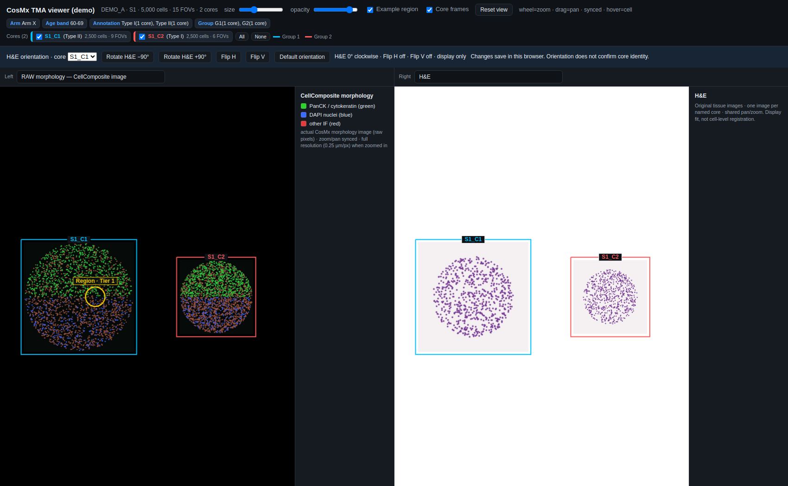

# cosmx-tma-viewer

**Self-contained HTML viewers for CosMx TMA experiments: one file per unit (e.g. patient × slide), no server, no install.**

Each viewer is a single offline HTML file that carries, inline:

- every cell as a point in slide microns, coloured by a three-level cell-type hierarchy (L1 / L2 / L3), any panel gene
  or any IF channel;
- the instrument morphology image of **every FOV** of every core, painted with exactly the same transform as the
  cells, plus an optional **full-resolution layer** (e.g. 0.25 µm/px) that loads only when you zoom in;
- an optional per-core H&E image in a synced second panel, with per-core rotate / flip controls;
- a frame per TMA core with its own annotation, colour-coded by a core group you define;
- optional **regions** (e.g. curated or detected structures) drawn as tier-styled outlines with an evidence tooltip;
- two linked pan/zoom canvases, a searchable feature picker, click-to-recolour legends, per-cell hover.

A landing page (`build_index.py`) lists every viewer with its cores, cell counts and optional per-core **flags**.

**This repository is code only.** Built viewers embed study data and metadata; they, and every input table, image
and count matrix, are excluded by `.gitignore`. `input/make_demo_data.py` generates a fully synthetic cohort so the
whole pipeline can be run and tested without any real data.

## Quick start (synthetic demo)

```bash
pip install numpy pandas scipy pillow requests websocket-client
bash run_demo.sh            # writes demo/data, demo/out/*.html and demo/out/index.html, then runs the browser checks
```



## Layout

| Path | What it is |
|---|---|
| `input/build_viewer.py` | Builds one viewer per unit from plain tables (see `docs/inputs.md`). |
| `input/viewer_template.html` | The viewer shell (HTML/CSS/JS). The builder fills in `DATA` and `CFG`; nothing study-specific is hard-coded. |
| `input/build_index.py` | Landing page; reads every figure back out of the built viewers; optional per-core flags. |
| `input/make_fov_tiles.py` | Resizes raw FOV images into overview / full-resolution tiles (run where the raw images live). |
| `input/verify_viewer.py` | Headless-Chrome checks of what a user actually sees (see `docs/features.md`). |
| `input/make_demo_data.py`, `input/demo_config.json` | Synthetic demo cohort and its config. |
| `input/cohort_config.example.json` | Annotated config template; copy to `cohort_config.json` (gitignored). |
| `docs/` | Input formats, feature list, changelog. |
| `legacy/` | The previous AnnData-based pipeline (`build_sample_viewer.py` + post-processing chain), kept for reference. |

## Building your own viewers

```bash
cp input/cohort_config.example.json cohort_config.json        # edit: wording, colours, fields; keep it out of git
python input/build_viewer.py --cells cells.tsv.gz --cores cores.tsv --units units.tsv \
       --fov-positions fov_positions.tsv --config cohort_config.json --out viewers \
       --counts-dir export/ --fov-images tiles_overview/ --fov-images-hires tiles_full/ \
       --he-images he/ --regions regions.tsv
python input/build_index.py viewers --flags flags.tsv --config cohort_config.json
python input/verify_viewer.py viewers/*.html --report verify.json      # exit code 1 if any check fails
```

Only `--cells --cores --units --fov-positions --out` are required; every other input adds a layer.

## Design notes

- **One transform per core.** Native slide coordinates are `X = px · (x_global + x_local)`, `Y = px · (−y_global + y_local)`
  (CosMx convention, `px` = 0.12028 µm). Each core is moved into its layout slot by a single translation; cells, FOV
  tiles, full-resolution tiles and regions all go through it, so they stay registered by construction and every core
  keeps true microns (no per-axis stretching).
- **Frames contain every cell.** A core's frame is its cells' bounding box plus a margin; the slot grows to fit the
  largest core. Rows of cores can share one frame top/bottom (`layout.align_rows`).
- **Hidden-by-default categories** (e.g. a QC-fail class) are hidden in every view (cell types, genes, channels) and
  never hovered; in cell-type views their legend entry can still show them.
- **Morphology and H&E layers show no cell tooltip**; hovering a core or region label shows its annotation.
- **Full-resolution morphology is lazy**: per-core images are decoded only when the view is zoomed beyond the overview
  resolution and the core is on screen.
- Built viewers are large (5–80 MB, mostly the expression store and images). Share them as files, not through git.

## Sharing built viewers

Built viewers contain whatever unit, core and annotation fields you configure. Review the config before sharing;
`legacy/deidentify_viewer.py` shows one way to mask annotation fields in an already-built viewer.

## License

MIT (see `LICENSE`).
